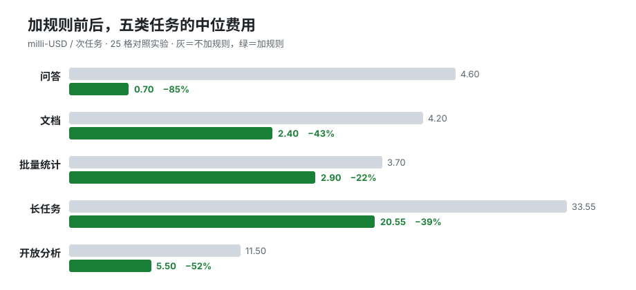
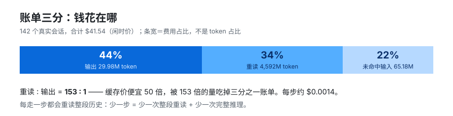

# stepwise

一套给 AI agent 省 token 的指令规则和测费脚本。

前阵子我统计了自己 142 个真实 agent 会话的账单，发现最费钱的其实不是模型话多。可见回答只占输出 token 的 5–10%，真正把账单拉高的是**工具调用步数**：每多走一步，就要把整段上下文按缓存价重读一遍，再做一次完整推理。把 10 次分散读写合并成 1 个脚本、把长文档改成一次写完，比让模型"回答简短一点"省得多。

我把这些做法收成 10 条可以直接贴进 `AGENTS.md` 或 system prompt 的规则，也在 5 类常见任务上跑了一遍前后对照。只加规则、不动工具配置、不换模型，五类任务加总中位费用降了 **43%**。

仓库里放了四部分东西：

| 文件 | 内容 | 用法 |
|---|---|---|
| [RULES-quick.md](RULES-quick.md) | 10 条精简规则 | 直接复制进 `AGENTS.md` 或 system prompt |
| [RULES.md](RULES.md) | 完整版（15 条规则 + 4 条避坑项，附实测数据） | 想看每条规则的依据时翻 |
| [SETUP.md](SETUP.md) | 输入端清理清单 | 交给 agent 照着精简一次环境配置（带确认与回滚） |
| [bench/](bench/) | 6 配置 × 5 任务的测费脚本 | 想自己复测时跑（需 DSH） |

## 直接上手

不需要装插件，也不用配 API key。把 [RULES-quick.md](RULES-quick.md) 里的 10 行粘进你的 agent 指令文件就能用。

其中省得最多的三条是：

1. **能一次做完的事别拆多步**：遍历目录、处理十来个文件、连跑几条命令，优先写个小脚本或拼成一条命令一次跑完。
2. **长文档一次 `write` 写全，修改尽量一次 `edit` 改完**：实测同一篇长文档，1 次写入只走 4 步，拆成 20 次零碎写入走了 50 步。
3. **查过的文件和写过的脚本别反复重来**：环境信息记进档案，要复用的脚本留着，不要每轮重新探查或整文件重写。

## 前后对照数据

同一批任务，只往指令里加这套规则前后的中位费用（单位 milli-USD，千分之一美元 / 次任务）：

| 任务类型 | 不加规则 | 加规则 | 变化 |
|---|---:|---:|---:|
| 问答 | 4.60 | 0.70 | −85% |
| 文档写作 | 4.20 | 2.40 | −43% |
| 批量统计（20 个文件） | 3.70 | 2.90 | −22% |
| 长任务（24–46 步） | 33.55 | 20.55 | −39% |
| 开放分析 | 11.50 | 5.50 | −52% |



注：每格有效样本 1–7 次，这里只报中位数；25 格完整数据和空跑判定口径见 [bench/README.md](bench/README.md)。

## 为什么省步数比省字数划算

Agent 每执行一步，系统提示、工具定义、常驻技能、`AGENTS.md` 和此前的全部对话历史都会再送进模型一次。把我那 142 个真实会话的费用拆开看，结构是这样的：



上下文重读量和输出量的比例高达 **153 : 1**。哪怕缓存命中价便宜 50 倍，靠步数叠起来依然吃掉三分之一的账单。所以：

- 压回答字数天花板很低，因为最终回复只占全部输出 token 的 5–10%（大头在推理和工具调用参数里）。
- 精简系统提示也有上限，固定前缀在每步输入里只占约 12%。
- 减少不必要的来回步数，才能同时把推理输出和全文重读一起砍下来。

## 几个实测下来效果不好（甚至更贵）的做法

网上常见的几种省 token 技巧我也顺手测了一遍，至少在我的任务集上收益不明显：

- **硬规定"默认不建文件"**：同一条文档任务，加上这条禁令反而贵了 **36%**，因为模型每一步都在反复琢磨当前任务算不算例外。实际浪费大头是频繁重写中间脚手架。抽查 22 个历史会话，总共 1,664 次写入、581 个文件，单个构建脚本最多被反复写了 **51 次**。
- **删掉整个子代理 / workflow 工具组**：在四类任务上合计几乎没省钱（问答 −26%、文档 +36%、批量统计 0%、长任务 −13%）。
- **只压最终回复长度**：把回答字数砍半，多步任务的总花费只降了个位数。

## 复测脚本与历史账单统计（DSH 专用）

如果你也在用 DSH，可以跑一遍测量台，或者直接扫自己的本地历史会话：

```bash
git clone https://github.com/HbS66-pro/stepwise && cd stepwise
cp bench/config.example.json bench/config.json      # 填入 dshBin 和 credentials 路径
node bench/setup.mjs                                # 建立 6 个隔离的 DSH_HOME
node bench/run.mjs --configs c0,c2 --tasks t1,t2 --runs 3
node bench/report.mjs                               # 输出净额对照表
```

`bench/` 已经处理了几个容易影响结果的变量（工作目录变化导致前缀缓存失效、冷热缓存单价差 50 倍、各配置需要单独预热），细节见 [bench/README.md](bench/README.md)。

只想看自己过去花在哪、不想跑对照实验的话，直接运行 `tools/` 下的只读脚本：

```bash
DSH_HOME=~/.dsh node tools/output-report.mjs   # 输出 / 缓存重读 / 未命中三项占比
DSH_HOME=~/.dsh node tools/fixed-tax.mjs       # 每步固定前缀开销
DSH_HOME=~/.dsh node tools/session-stats.mjs   # 落盘、重写和工具返回体量统计
```

## 数据边界与局限

- **测试环境单一**：规则本身不挑工具，但文中的所有费用数据都是在 **DSH + deepseek-flash** 上测出来的。换其他 agent 或模型，绝对金额不能直接照搬，只能参考大致比例。
- **样本量不大**：每格 1–7 次，其中长任务样本只有 2 次，所以只报中位数和范围，不报均值。
- **未覆盖场景**：超过 200 步的超长会话、多 agent 协作以及纯英文任务还没有测。
- **计价口径**：按闲时单价换算（cacheHit 0.003 / cacheMiss 0.15 / output 0.6 美元每百万 token）；峰时整体翻倍，各项占比不变。
- **脚本依赖**：`bench/` 和 `tools/` 依赖 DSH 的日志格式；`RULES-quick.md`、`RULES.md` 和 `SETUP.md` 任何 agent 都能直接用。

## 目录结构

```text
RULES-quick.md   10 条精简规则，直接复制使用
RULES.md         完整规则、避坑项与实测依据
SETUP.md         输入端一次性清理说明（可交给 AI 执行）
bench/           对照测量台（setup / run / report、配置与任务集）
tools/           DSH 本地历史会话只读统计脚本
docs/            早期立项与路线记录
data/            统计口径说明（不含真实会话日志）
assets/          README 用到的两张 SVG 图
```

## 隐私说明

仓库里不包含任何真实会话记录。`bench/config.json`、`bench/results/`、`bench/_homes/`、`bench/_work/` 和 `data/*.json` 均已加入 `.gitignore`。注意 `bench/_homes/*/.credentials.yaml` 里有凭据副本，打包分享本地目录时别带上。

---

## English Summary

After analyzing 142 of my own agent sessions (DSH + `deepseek-flash`), I found that visible replies only account for 5–10% of output tokens. Most of the bill comes from the **number of tool-call steps**, because every extra step triggers another reasoning pass and re-reads the entire conversation context (cached reread vs. output ratio was 153:1).

This repo collects:

- [RULES-quick.md](RULES-quick.md): 10 rules you can paste directly into `AGENTS.md` or a system prompt (no install required).
- [RULES.md](RULES.md): the full rule set plus 4 practices that did not help in testing, with measured numbers.
- [SETUP.md](SETUP.md): a one-time context/input cleanup checklist an agent can run for you.
- [bench/](bench/) and [tools/](tools/): benchmark and log-analysis scripts for DSH.

Across 5 task types (25 benchmark cells, 1–7 runs per cell), adding the rules alone reduced median aggregate cost by **43%** (from −85% on Q&A to −22% on 20-file batch stats). The biggest gains come from batching file/shell work into single calls, writing long documents in one pass, and avoiding repeated re-reads or rewrites.

Licensed under MIT. Prior art is noted in [NOTICE](NOTICE).
