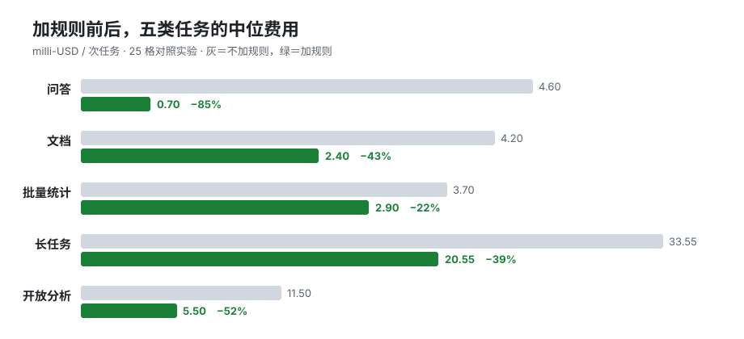
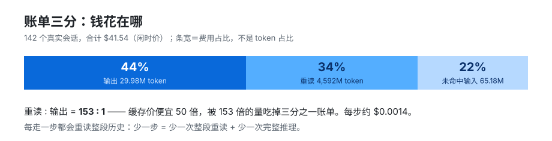

# stepwise

**给 AI agent 省钱的规则集：一次少走一步，账单少三成。**

我们量了 142 个真实 agent 会话，结论很简单：一次会话的账单 ≈ **步数 ×（一次推理 + 一次全文重读）**。

可见回答只占输出 token 的 5–10% —— 所以"写短"最多省个位数。省掉**一步**，省的是整份上下文重读加一整段推理。**杠杆在步数，不在字数。**

这个仓不是插件、不是预置包、不需要安装。四样东西：

| 文件 | 是什么 | 怎么用 |
|---|---|---|
| **[RULES-quick.md](RULES-quick.md)** | 10 条规则，全是能直接复制的句子 | 粘进 `AGENTS.md` / system prompt，下一轮就生效 |
| **[RULES.md](RULES.md)** | 完整版：12 条规则 + 4 条禁手，每条带实测数字 | 想按证据逐条挑时读 |
| **[SETUP.md](SETUP.md)** | 输入端一次性改造书 | 丢给你的 AI，让它照做（带询问、验收、回滚） |
| **[bench/](bench/)** | 测量台：6 配置 × 5 任务 | 想验证"到底省多少"再跑，需 DSH |

## 一眼看效果

同一批任务，只往指令里加规则前后的中位费用（milli-USD，千分之一美元 / 次任务）：

| 任务 | 不加规则 | 加规则 | 变化 |
|---|---|---|---|
| 问答 | 4.60 | **0.70** | **−85%** |
| 文档 | 4.20 | 2.40 | −43% |
| 批量统计（20 个文件） | 3.70 | 2.90 | −22% |
| 长任务（24–46 步） | 33.55 | **20.55** | **−39%** |
| 开放分析 | 11.50 | **5.50** | **−52%** |

按这五类任务的量加总，**整张账单降 43%**。只加规则、不改工具、不换模型。



样本 1–7 次/格，只报中位数；完整 25 格对照与口径见 [bench/README.md](bench/README.md)。

## 30 秒上手（不需要安装）

把 [RULES-quick.md](RULES-quick.md) 的 10 行粘进你的 agent 指令就完了。没有依赖、没有配置、没有 API key 要填。

最值钱的三条：

1. **一次调用做完一件事** —— 10 个文件、3 个命令、2 个搜索，写一个脚本或发一条命令，别拆成 10 次工具调用。
2. **长文档一次 `write` 写全**，改就用一次 `edit` 改完。实测：1 次写入 = 4 步，20 次写入 = 50 步。
3. **同一件事不重复做** —— 文件不无理由重写，环境不反复探查，要复用的脚本留着。

## 为什么这几条能省钱

每走一步，提示词前缀（系统提示 + 工具表 + 常驻技能 + AGENTS.md + 整段历史）都会按缓存价重读一遍。142 个会话的账单拆开是这样：



重读:输出 = **153 : 1**。缓存价再便宜 50 倍，也被这个倍数量吃掉了三分之一的账单。所以：

- 输出端"写短"有天花板：可见回答只占输出 token 的 5–10%。
- 输入端也有天花板：固定税只占每步输入的约 12%。
- **真正能动的是步数**：少一步 = 少一次推理 + 少一次全文重读。

## 我们证明了什么是错的

省 token 圈子流传的三种做法，我们用自己的账单验了一遍，都不成立：

- **"默认不建文件"是错的靶子。** 同一条文档任务，带这句禁令比不带贵 **36%**——模型每步都在判断"这算不算那三种例外"。真正的浪费在中间稿和反复重写的脚手架：抽查 22 个会话，1,664 次写入、581 个文件，单个构建脚本被写 **51 次**。
- **删工具不省钱。** 删掉整个 delegation 组（子代理/workflow/ralph），四类任务合计约 0 收益（问答 −26%、文档 +36%、批量 0%、长任务 −13%）。
- **写短不是主杠杆。** 把答案砍半，多步任务的总费只降个位数。

## 想验证？跑你自己的净额表（需 DSH）

```bash
git clone https://github.com/HbS66-pro/stepwise && cd stepwise
cp bench/config.example.json bench/config.json      # 填 dshBin 和 credentials 路径
node bench/setup.mjs                                # 建 6 个隔离 DSH_HOME
node bench/run.mjs --configs c0,c2 --tasks t1,t2 --runs 3
node bench/report.mjs                               # 出净额表
```

`bench/` 对每个配置建独立 `DSH_HOME`，用 `dsh --profile <p> --json` 跑固定任务，逐次记录步数、输出 token、缓存重读、未命中输入、工具调用、写入次数、返工次数、落盘字节、耗时。三个已经踩过的坑（cwd 进系统提示、冷缓存差 50 倍、预热必须分配置做）都在实现里处理掉了，见 [bench/README.md](bench/README.md)。

不跑实验、只想看自己的历史会话花了多少：

```bash
DSH_HOME=~/.dsh node tools/output-report.mjs   # 账单三分
DSH_HOME=~/.dsh node tools/fixed-tax.mjs       # 每步固定税
DSH_HOME=~/.dsh node tools/session-stats.mjs   # 落盘/返工/工具结果体量
```

## 适用范围（先看边界）

- **规则与厂商无关**：成本结构在所有主流 agent 上都成立。但**实验数据全部在 DSH + deepseek-flash 上测得**，别的 harness 只能参考比例，不能搬绝对金额。
- **样本很薄**：1–7 次/格，长任务只有 2 次。只报中位数和范围，不报均值。
- **没覆盖**：200 步以上的超长会话、多 agent 协作、非中文任务。
- **价格**：cacheHit 0.003 / cacheMiss 0.15 / output 0.6（美元/百万 token），闲时价；峰时翻倍，占比不变。
- **DSH 专属**：`bench/` 和 `tools/` 只跑在 DSH 上；`RULES*.md` 和 `SETUP.md` 与 harness 无关。

## 仓库结构

```
RULES-quick.md   10 条规则，复制即用
RULES.md         完整规则 + 禁手，每条带依据
SETUP.md         输入端一次性改造书（给 AI 执行）
bench/           测量台：run/setup/report + 配置 + 任务 + 规则文本
tools/           历史会话账单脚本（DSH 专用，只读）
docs/            项目定义与路线（早期文档，当背景读）
data/            口径说明，不含真实数据
assets/          README 里的图
```

## 隐私

仓库里**没有任何真实会话数据**。以下只在本地存在，都在 `.gitignore` 里：`bench/config.json`、`bench/results/`、`bench/_homes/`、`bench/_work/`、`data/*.json`。

`bench/_homes/*/.credentials.yaml` 是凭据副本——**不要把整个目录打包上传**。

## English

**Cutting steps, not words, is the lever.** An agent session's bill ≈ steps × (one reasoning pass + one full-context reread). Visible answers are only 5–10% of output tokens, so "write shorter" saves single digits; removing a step saves a whole input reread plus a whole reasoning pass.

Not a plugin, not a preset pack. It is: [RULES-quick.md](RULES-quick.md) (10 copy-paste rules), [RULES.md](RULES.md) (full rules + anti-patterns, each backed by measurements), [SETUP.md](SETUP.md) (a one-time input-side cleanup guide for an AI to execute), and [bench/](bench/) (a reproducible benchmark).

Measured on 142 real sessions (DSH + deepseek-flash) and 25 benchmark cells over 5 task types: adding the rules cut the bill by **43%** in aggregate, from −85% (Q&A) to −22% (batch stats). Best value comes from reducing the **number of tool-call steps** — 1 write instead of 20 edits; one script instead of ten file reads.

MIT. See [NOTICE](NOTICE) for prior art.
